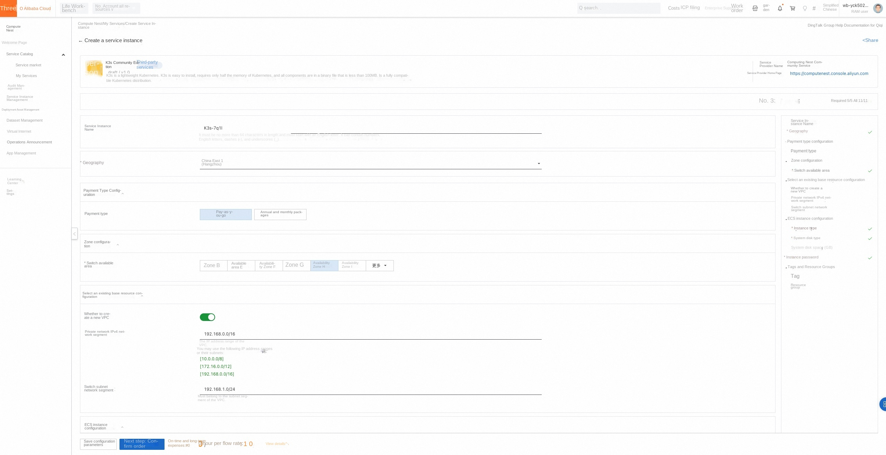
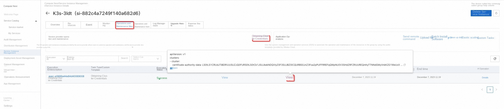
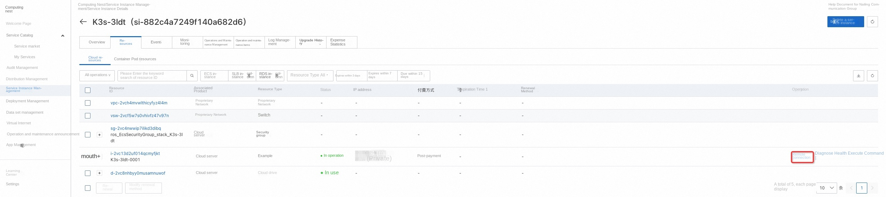
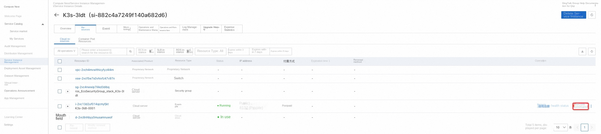
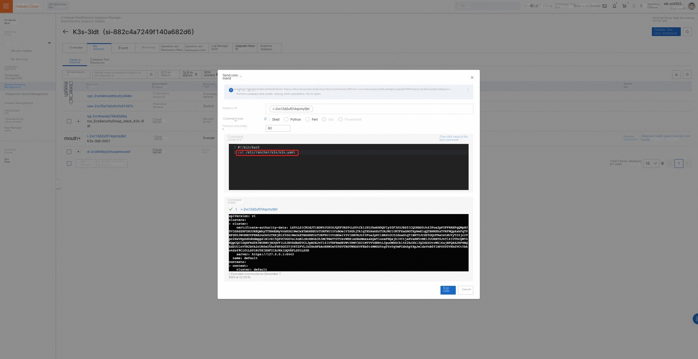
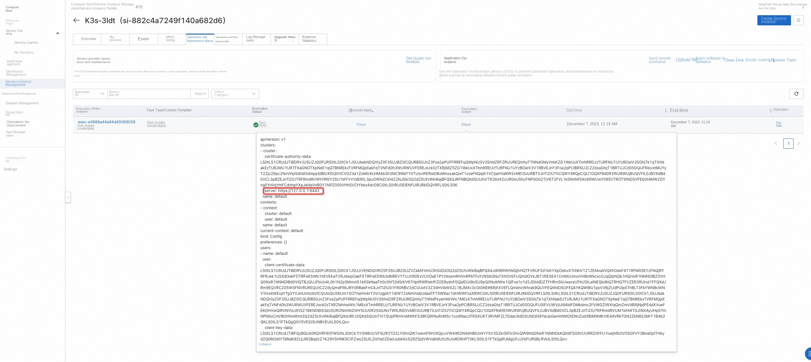
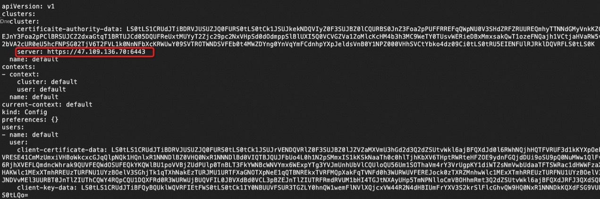
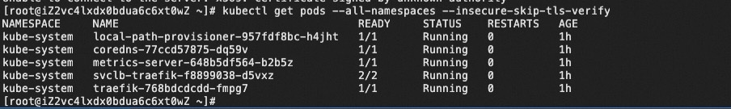

# K3s Community Edition Service Instance Deployment Document

## Overview

[K3s](https://docs.k3s.io/zh/) is a fully compatible Kubernetes release with the following enhancements:

-Packaged as a single binary file.
-Use a lightweight storage backend based on sqlite3 as the default storage mechanism. It also supports etcd3, MySQL, and Postgres.
-Encapsulated in a simple startup program, it can handle many complex TLS and options.
-It is safe by default and has reasonable default values for lightweight environments.
-Added simple but powerful batteries-included functions, such:
-Local Storage Provider
-service load balancer
-Helm controller
-Traefik ingress controller
-All operations Kubernetes control plane components are encapsulated in a single binary file and process. As a result, K3s enables the automation and management of complex cluster operations (such as certificate distribution, etc.).
-Minimizes external dependencies, K3s requires only modern kernels and cgroup mounts. K3s packages the required dependencies, including:
-containerd
-Flannel (CNI)
-CoreDNS
-Traefik (Ingress)
-Klipper-lb (Service LB)
-Embedded Network Policy Controller
-embedded local-path-provisioner
-Host utilities (iptables, socat, etc.)

This article introduces you to the process and instructions for deploying an instance based on the K3s Community Edition service.

## Billing Description

The cost of the K3s Community Edition on the computing nest mainly involves:

-Selected vCPU and memory specifications
-Disk Capacity
-public network bandwidth

Billing methods include:

-Pay-As-You-Go (hours)
-Package year and package month

The estimated cost can be seen in real time when the instance is created.

## Deployment Architecture

K3s Community Edition is a stand-alone deployment architecture.

## Permissions required for RAM accounts

The K3s community edition service needs to access and create resources such as ECS and VPC. If you use a RAM user to create a service instance, you need to add the corresponding resource permissions to the account of the RAM user before creating the service instance. For details about how to add RAM permissions, see [Authorize RAM users](https://help.aliyun.com/document_detail/121945.html)
。 The required permissions are shown in the following table.

| Permission policy name | Comment |
| ------------------------------------- | ------------------------ |
| AliyunECSFullAccess | Permissions to manage ECS instances |
| AliyunVPCFullAccess | Permissions to manage a VPC |
| AliyunROSFullAccess | Manage permissions for Resource Orchestration Service (ROS) |
| AliyunComputeNestUserFullAccess | Manage user-side permissions for the compute nest service (ComputeNest) |
| AliyunCloudMonitorFullAccess | Permissions to manage CloudMonitor (CloudMonitor) |

## Deployment process

### Deployment steps

Click Deployment Link (https://computenest.console.aliyun.com/service/instance/create/cn-hangzhou?type=user&ServiceId=service-2f7333225ee342ee8fa7)
, enter the service instance deployment interface, according to the interface prompt, fill in the parameters to complete the deployment.

### Deployment parameter description

When you create a service instance, you need to configure the service instance information. The following section describes the details of the K3s Community Edition service instance input parameters.

| Parameter group | Parameter item | Example | Description |
| ------------ | -------- | --------------------------------------------------------------------------- |
| Service instance name | | test | Instance name |
| Region | | China (Hangzhou) | Select the region of the service instance. We recommend that you select the region nearby to obtain better network latency. |
| Availability Zone Configuration | Deployment Region | Zone I | Different Availability Zones in a Region |
| Payment Type Configuration | Payment Type | Pay-As-You-Go or Subscription |
| Select an existing basic resource configuration | VPC ID | vpc-xxx | Select the VPC ID. |
| Select the existing basic resource configuration | VSwitch ID | vsw-xxx | Select the VSwitch ID. If the switch cannot be found, try switching the region and zone |
| ECS instance configuration | Instance type | ecs.g6.large | Instance type, which can be selected according to actual needs |
| ECS instance configuration | System disk space | 40 | System disk space can be selected according to actual needs |
| ECS instance configuration | Data disk space | 40 | Data disk space can be selected according to actual needs |
| ECS instance configuration | Instance password | ******** | Set the instance password. It must be 8 to 30 characters in length and must contain three items (uppercase letters, lowercase letters, numbers, ()'~!@#$%^& *-+ ={}[]:;' <>,.?/special symbols) |

### Validation Results

1. View the service instance.
After the service instance is created successfully, the deployment time takes about 2 minutes. After the deployment is complete, the corresponding service instance is displayed on the page.

2. Obtain cluster access credentials:
-Method 1: On the Operation and Maintenance Management page, select the operation and maintenance item "Obtain Cluster Voucher" and view the voucher in the execution result.

-Method 2: Connect to the service node remotely and obtain the access credential:/etc/rancher/k3s/k3s.yaml

-Method 3: Send a remote command: cat /etc/rancher/k3s/k3s.yaml to view the execution result of the command

3. Configure credentials on nodes outside the cluster to access the cluster:
-private network access: write the credential file in ~/.kube/config, replace the server-ip in the credential with the private network ip of the service instance (obtained on the overview page), and use the kubectl command to access the cluster.

'''
kubectl get pods --all-namespaces
'''
-public network access: write the credential file in ~/.kube/config, replace the server-ip in the credential with the public IP of the service instance (obtained on the overview page), and use the kubectl command to access the cluster.
'''
kubectl get pods --all-namespaces --insecure-skip-tls-verify
'''

### Use K3s

Please visit the K3s website to learn how to use K3s:[K3s Usage Documentation](https://docs.k3s.io/zh/)
